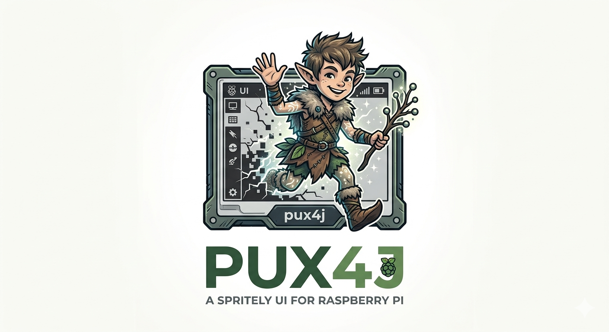

# pux4j — Pi User Experience for Java

<p align="center">
  
</p>

`pux4j` is a Java 25 library for driving WaveShare eInk displays on Raspberry Pi and
integrating them with JavaFX applications.

Write a standard JavaFX application. On desktop it renders normally. On a Raspberry Pi with
a WaveShare eInk HAT (an add-on board that plugs onto the Pi) it drives the eInk panel instead — no
hardware-specific logic in your application code. Two HATs are supported today. You can try everything
without any hardware: a window on your computer, the **emulator**, behaves like the eInk panel.

---

## The four demo apps

`pux4j` comes with four small apps, so you can see what it does and check that a display works.

| App | What it is |
|---|---|
| `demo` | A counter. Tap the **−** and **+** buttons to change the number. |
| `dice-demo` | Five dice. Roll them up to three times in a turn; before the second and third roll, tap a die to save it. **Clear** starts again. |
| `smoke` | A quick check of the display. It draws a short series of test patterns (arrows, bars, stripes, a checkerboard and some boxes) and ends with PASS or FAIL. It does not use touch. |
| `validation` | A step-by-step check of the display and the touch screen. It asks you to tap targets on the panel and reports PASS or FAIL for each of its 10 steps, then writes a report file. |

`demo` and `dice-demo` are **JavaFX apps**: ordinary JavaFX programs that `pux4j` shows on the panel.
`smoke` and `validation` are **driver tests**: they talk to the display and touch hardware directly,
without JavaFX, so they are useful for checking a new setup.

---

## Ways of working

`pux4j` is built with [Maven](https://maven.apache.org/), a Java build tool. There are three ways to use it:

1. **Try it in the emulator.** On an x86_64 Linux machine with Java 25 and Maven. No Raspberry Pi and no
   HAT are needed. Start here: [Try it: run the emulator](#try-it-run-the-emulator).
2. **Build on an x86_64 machine and deploy to a Raspberry Pi.** Your desktop, laptop or a server is the
   *build machine*: it builds the software and copies it to the Pi over `ssh`. This is the way documented
   from [Supported hardware](#supported-hardware) onwards.
3. **Build and run entirely on the Raspberry Pi.** Planned, but not yet documented or tested.

The same apps can also be built as **native images**: programs compiled ahead of time so that they start
without a Java runtime. That lives in the separate [`pux4j-native`](https://github.com/darranl/pux4j-native)
project, which builds on the results of this one.

---

## Try it: run the emulator

No hardware needed. The emulator is selected automatically on any machine that is not a Raspberry Pi.
Mouse press and release stand in for touching the panel.

**You need:** Java 25 (any JDK 25 distribution) and Maven (3.9 and 3.10 tested), on an x86_64 Linux
machine (tested on Arch Linux). The first build downloads the dependencies from Maven Central, so it
needs network access and takes a few minutes. Some JavaFX tests are skipped when there is no display,
and Pi4J logs a "no suitable user group" error line in some tests on a build machine; both are expected.

All commands run from the root of the `pux4j` repository.

```bash
mvn install                                     # once, and after changing sources
pux4j-bundle/run-emulator.sh --list           # the apps
pux4j-bundle/run-emulator.sh demo             # counter app
pux4j-bundle/run-emulator.sh dice-demo        # dice rolling app
pux4j-bundle/run-emulator.sh smoke            # raw display smoke test (no bridge)
pux4j-bundle/run-emulator.sh validation       # interactive display + touch test (mouse = touch)
```

`mvn install` builds and tests everything and leaves the **emulator bundle**: a directory with all the
Java libraries (jars) the apps need. The script only runs what the last build left; it never builds. After
you change sources, build again. To emulate the other panel, or to change the window size, see
[More on the emulator](#more-on-the-emulator).

---

## Project layout

The `pux4j` repository is a Maven multi-module project, which means one repository holds several modules
(small libraries and programs) that are built together:

```
pux4j/
├── pux4j-core/                 Driver interfaces, service discovery, shared types — no JavaFX
├── pux4j-driver-hat-2in9v2/    Drivers for the 2.9" V2 HAT (SSD1675A display, ICNT86X touch)
├── pux4j-driver-hat-2in13v4/   Drivers for the 2.13" V4 HAT (SSD1680 display, GT1151Q touch)
├── pux4j-transform/            Pixel transformation pipeline — pure Java, no JavaFX, no Pi4J
├── pux4j-emulator/             JavaFX visual emulator — development and test only
├── pux4j-fx/                   JavaFX bridge + the SceneContent service interface
├── pux4j-app-spi/              The DriverApp service interface for non-JavaFX tests
├── pux4j-launcher/             The pux4j launcher library: runs JavaFX apps and driver tests
├── pux4j-validation/           Smoke test and interactive hardware validation test
├── pux4j-demo/                 Counter demo (plain JavaFX app + SceneContent provider)
├── pux4j-dice-demo/            Dice demo
├── pux4j-bridge-smoke/         Headless checks that play the demos through the bridge
└── pux4j-bundle/               Builds the runnable bundles (emulator and Pi); nothing depends on it
```

How the pieces fit together: `pux4j-core` defines what a display driver and a touch driver are. Each HAT has
its own driver module (`pux4j-driver-hat-…`) that implements them for that HAT's chips. `pux4j-transform`
and `pux4j-fx` turn what a JavaFX app draws into frames for the panel, and turn touches back into mouse
events. `pux4j-launcher` finds and runs the apps. `pux4j-bundle` puts it all together into a **bundle**: a
directory with the jars, scripts and settings needed to run the apps. Which driver module goes into a
bundle is chosen when you build (see [Build for a Raspberry Pi](#build-for-a-raspberry-pi)); the emulator
bundle contains the emulator instead of a HAT driver. More detail on each module is under
[Architecture](#architecture).

The same apps can also be built as native images, and a native C API is planned; both live in the
separate `pux4j-native` repository, see its README.

---

## Supported hardware

A HAT ("Hardware Attached on Top") is an add-on board that plugs onto the 40-pin header of a Raspberry Pi.
For each HAT, this table gives the names used by the build, the emulator and the drivers.

| Common name | Panel | Display chip | Touch chip | Tested on | Build profile (`-P`) | Emulator profile |
|---|---|---|---|---|---|---|
| **2.9" Touch e-Paper HAT (V2)** | 296×128, monochrome and 4-gray | SSD1675A | ICNT86X | Raspberry Pi 500+ | `bundle-hat-2in9v2` | `ssd1675a` |
| **2.13" Touch e-Paper HAT (V4)** | 250×122, monochrome | SSD1680 | GT1151Q | Raspberry Pi Zero 2 W | `bundle-hat-2in13v4` | `ssd1680` |

- Both are tested on Raspberry Pi OS 12 (Debian bookworm), 64-bit (aarch64). Any other Pi with the
  40-pin header should work with the same HAT but has not been tested.
- **The HAT is chosen when you build, not detected.** The drivers only check that they are
  running on a Raspberry Pi; nothing probes which HAT is attached. A bundle contains the drivers
  for exactly one HAT, so build the bundle that matches the HAT on that Pi. A mismatch does not
  produce an error: the panel simply shows nothing sensible.

---

## What you need for a Raspberry Pi

**On the build machine (where you build):** what you need for the emulator (Java 25 and Maven), plus
`ssh` access to the Pi (key-based login is easiest).

**On each Raspberry Pi (where you run):**

1. **Java 25** on the default `PATH` (the JVM bundle runs on the Pi's own JDK). A JDK 25 for
   Linux aarch64 is available from [Adoptium Temurin](https://adoptium.net/temurin/releases/?version=25)
   ([Linux installation instructions](https://adoptium.net/installation/linux/)). Check with
   `java -version`. `pux4j` runs whichever `java` comes first on the `PATH` (`JAVA_HOME` is
   ignored). The deploy check looks in a non-interactive `ssh` shell and warns if it finds no Java
   25 there; a JDK that is only put on the `PATH` in login shells triggers that warning, though
   you can still run the apps from a login shell on the Pi.
2. **SPI and I2C enabled.** Both are off by default. Follow the Raspberry Pi documentation:
   [Enable or disable SPI](https://www.raspberrypi.com/documentation/computers/configuration.html#spi) and
   [Enable or disable I2C](https://www.raspberrypi.com/documentation/computers/configuration.html#i2c)
   (`sudo raspi-config`, then **Interface Options**; or **Preferences → Control Centre →
   Interfaces** on the desktop). Reboot afterwards. You can confirm with
   `ls /dev/spidev0.0 /dev/i2c-1`.
3. **A desktop session**, for the JavaFX apps (`demo`, `dice-demo`). JavaFX needs one to start
   even though nothing is shown on it. Raspberry Pi OS with the desktop has one by default (a
   monitor does not need to be attached). The `smoke` and `validation` tests do not need it. See
   [DISPLAY](#display-and-the-desktop-session).
4. **`tar`** on the Pi (a standard part of Raspberry Pi OS).

You do not need `~/bin` on the Pi's `PATH`. If it is not, call `~/bin/pux4j` or the full path
that the deploy script prints.

---

## Build for a Raspberry Pi

A Maven **profile** is a named switch for the build, chosen with `-P`. The profiles in this project decide
which HAT the build is made for: the `bundle-hat-<hat>` profile adds that HAT's driver module (and the
aarch64 JavaFX libraries the Pi needs) to the bundle. A build without one of these profiles, such as
`mvn install`, produces the emulator bundle, which has no hardware driver. A bundle holds the drivers for
exactly one HAT, and nothing detects the HAT when the app runs, so build the profile that matches the HAT on
the Pi (the names are in [Supported hardware](#supported-hardware)).

All commands run from the root of the `pux4j` repository.

```bash
mvn package -DskipTests -Pbundle-hat-2in9v2   # Pi bundle for the 2.9" V2 HAT  (driver module pux4j-driver-hat-2in9v2)
mvn package -DskipTests -Pbundle-hat-2in13v4  # Pi bundle for the 2.13" V4 HAT (driver module pux4j-driver-hat-2in13v4)
```

A Pi bundle is the directory `pux4j-bundle/target/pux4j/`. It is rebuilt from scratch each time,
so building the other HAT's bundle replaces it. Build, deploy, then build the other.

Nothing else runs a build for you: the run and deploy scripts only run and copy what the last
build produced. After you change sources, build again. The emulator bundle (`mvn install`) and a
Pi bundle (`-Pbundle-hat-...`) are separate outputs; building one does not refresh the other.

---

## Deploy to a Raspberry Pi

```bash
mvn package -DskipTests -Pbundle-hat-2in9v2     # the bundle that matches the HAT on that Pi
scripts/deploy.sh <host>                        # <host> is an ssh host name or address
```

Options: `--user <name>` (ssh user; default is your local user name), `--dir <dir>` (the directory
on the Pi that will contain the `pux4j` directory; default `applications`, relative to the Pi
user's home), `--dry-run` (print what it would do; nothing is copied). `scripts/deploy.sh --help`
shows them all.

The script does not build anything. It prints which HAT the bundle was built for and then:

1. runs read-only checks on the Pi and **warns** (it never changes system settings) if Java 25 is
   missing from the `PATH`, `/dev/spidev0.0` or `/dev/i2c-1` is absent, or `tar` is missing;
2. replaces the bundle's `lib/`, `bin/`, `conf/` and `byteman/` directories on the Pi with a `tar`
   stream over `ssh`. The `logs/` directory is kept;
3. runs `bin/install.sh` on the Pi, which creates `~/bin` if it does not exist and links `pux4j`
   into it. It does not edit any shell profile and does not use `sudo`.

---

## Run on the Raspberry Pi

```bash
pux4j --list                # the apps and the drivers in this bundle
pux4j demo                  # counter app          (JavaFX: needs the desktop session, see below)
pux4j dice-demo             # dice rolling app     (JavaFX)
pux4j smoke                 # display refresh test, no touch, no desktop needed
pux4j validation            # interactive 10-step display + touch test, no desktop needed
```

If `~/bin` is not on your `PATH` (on a fresh Pi it may only be added at your next login, after
the directory exists), use `~/bin/pux4j` or `~/applications/pux4j/bin/pux4j`.

### Which HAT is this bundle for?

`pux4j --list` ends with a line naming the display and touch drivers in the bundle (for example
`Display drivers: png, ssd1675a; touch drivers: icnt86x, programmatic`). That is how you check which HAT a
deployed bundle was built for. (`png` and `programmatic` are test drivers that are always present.)

### The validation test and command-line options

**The validation test** asks you to tap targets on the panel and checks that the touch coordinates
line up with what is drawn and that the display is the right way up. It writes
`validation-report-<timestamp>.txt` into the directory you ran it from. Options, passed after the
name: `--start-step <n>` (jump to a step), `--scenario-count <n>` or `--all-scenarios` (how many
scenarios to run; the default is all of them), `--notes "text"` (recorded in the report), and the
overrides `--display <driver>`, `--touch <driver>` and `--orientation <LANDSCAPE|LANDSCAPE_INVERTED|...>`
for non-standard setups. Any other option is rejected with "Unknown argument".

**Command-line options.** `-D<property>=<value>` arguments are JVM system properties
(display options such as `-Dpux4j.display.fourGrayLut=VENDOR|FLASH_FIRST|SPLIT_FLASH` for the 2.9"
4-gray waveform order, default `SPLIT_FLASH`). Everything else after the app name goes to the app
(the JavaFX apps ignore it; `smoke` and `validation` take it as their own options).
Exit codes: 0 success, 1 failure, 2 usage error (unknown or missing app name).
Stop an app with Ctrl-C; the panel is put to sleep on the way out and the last log lines are kept.

### DISPLAY and the desktop session

The JavaFX apps need a desktop session on the Pi, and the `DISPLAY` environment variable must
name it. `pux4j` defaults `DISPLAY` to `:0`. Over a plain `ssh` login `DISPLAY` is not set, and the
right value depends on the session, so **you may need to find your own**. Ways to find it:

```bash
ls /tmp/.X11-unix        # a socket X0 means :0, X1 means :1
pgrep -a Xwayland        # the display number is on the command line, e.g. "Xwayland :1 ..."
echo $DISPLAY            # run inside a terminal in the desktop session itself
```

Then set it before running the JavaFX apps: `export DISPLAY=:1`.

If it is wrong or unset, or there is no desktop session, a JavaFX app fails at start-up with:

```
ERROR [main] dev.pux4j.ui.launcher.EInkLauncher - App 'demo' failed
java.lang.UnsupportedOperationException: Unable to open DISPLAY
    at javafx.graphics@23.0.1/com.sun.glass.ui.gtk.GtkApplication...
```

`Unable to open DISPLAY` always means one of those three things.

### Logs and tracing

- Everything an app prints is also written to `logs/<app>.log` in the bundle directory
  (`~/applications/pux4j/logs/` by default). The file is replaced each time that app runs;
  `--list` and `--help` write none.
- `conf/logback-trace.xml` in the bundle is a verbose logging configuration:
  `pux4j demo -Dlogback.configurationFile=$HOME/applications/pux4j/conf/logback-trace.xml`
- `PUX4J_JAVA_OPTS` adds JVM options to a run, for example `PUX4J_JAVA_OPTS="-Xmx256m" pux4j demo`.
  The same variable carries a [ByteMan](https://byteman.jboss.org/) agent for SPI-level hardware
  tracing: the rule files are in the bundle's `byteman/` directory, the ByteMan agent jar is not
  shipped. `pux4j --help` shows an example.
- Pull a log back to the build machine with `scp <host>:applications/pux4j/logs/demo.log .`.

---

## More on the emulator

The emulator is the quickest way to try `pux4j` (see [Try it: run the emulator](#try-it-run-the-emulator)).
This section covers emulating the other panel, and what the emulator does not do.

### Emulating different hardware

| Option | Values | Default | Meaning |
|---|---|---|---|
| `-Dpux4j.emulator.display=<profile>` | `ssd1675a`, `ssd1680` | `ssd1675a` | The panel to emulate; the profile names are in the [hardware table](#supported-hardware) |
| `-Dpux4j.emulator.scale=<n>` | a positive integer | `3` | Window size: each panel pixel is drawn as n×n screen pixels |

```bash
pux4j-bundle/run-emulator.sh demo -Dpux4j.emulator.display=ssd1680 -Dpux4j.emulator.scale=4   # 2.13" panel, 4x
```

Each profile fixes the panel's size, its mounting orientation and the pixel formats it supports,
so the emulated window matches the real HAT: the 2.9" profile has 4-gray, the 2.13" profile is
monochrome only.

What the emulator does not do:

- **Only these two panels exist.** There is no option for another size. A new panel needs a new
  entry in the emulator's profile list in `pux4j-emulator`.
- **It does not model refresh time.** The roughly 3-second 4-gray refresh and ghosting of the real
  panel are not simulated; check those on hardware.
- **Touch is a straight mapping** from mouse position to panel coordinates, so the emulator cannot
  catch a wrong touch calibration on a real HAT. Use `validation` on the hardware for that.

### Headless checks

Headless checks play the demos on both panel sizes and write PNG frames, with no window:

```bash
pux4j-bridge-smoke/run-demo-check.sh
pux4j-bridge-smoke/run-dice-check.sh
```

See [`docs/bridge-demo-verification.md`](docs/bridge-demo-verification.md) for what to look for.

---

## Build and review Javadoc

`pux4j-core` includes a dedicated Maven profile for Javadoc generation.

```bash
mvn -pl pux4j-core -P docs -DskipTests package
xdg-open pux4j-core/target/reports/apidocs/index.html
```

---

## Architecture

The modules and how they fit together are described under [Project layout](#project-layout). This section
adds detail on the main ones.

### `pux4j-core` and the driver modules

`pux4j-core` defines `EInkDisplayDriver` and `TouchDriver` and their supporting types. Drivers are
found at runtime with `ServiceLoader`: which ones are available is decided by which driver modules
are on the module path, which is why a bundle contains one HAT's drivers. Each HAT module owns
its panel's facts (mounting orientation, touch calibration, pin defaults), so applications and
tools do not repeat them.

Also in core: `PngEInkDisplay`, a driver that writes frames as PNG files for headless and CI use.

### `pux4j-transform`

Converts RGBA pixel buffers into packed `FrameData` for a specific display and decides, from the
frame history and the display's capabilities, which refresh mode and region to use. No JavaFX, no
Pi4J, no native calls; fully unit-testable.

### `pux4j-fx`

The JavaFX bridge. It watches the scene graph with a pulse-driven `AnimationTimer`, converts frames
through `pux4j-transform`, pushes updates to the display on a dedicated virtual thread, and turns
hardware touch contacts back into JavaFX `MouseEvent`s.

### `pux4j-launcher`, `pux4j-bundle` and the two kinds of app

`pux4j-launcher` is a plain library, so an outside application can depend on it without pulling in
any demo, emulator or driver. `pux4j-bundle` is the module that builds the runnable bundles from it
(the emulator bundle in `target/run-lib`, a Pi bundle per HAT profile in `target/pux4j`), together
with the `pux4j` and `install.sh` scripts and `run-emulator.sh`; no module depends on it.

The launcher (`pux4j` on a Pi, `run-emulator.sh` on the build machine) lists and runs two kinds of app in
one name space:

- **JavaFX apps** (`SceneContent` providers, such as `demo` and `dice-demo`) run through the
  bridge. A JavaFX app has no knowledge of drivers; which ones it runs against is decided by what
  the bundle contains.
- **Driver tests** (`DriverApp` providers, such as `smoke` and `validation`) are deliberately not
  JavaFX: they test the raw drivers without the bridge. Everything after their name on the command
  line is passed to them.

If two apps report the same name, each is listed under its simple class name instead (and under its
fully qualified class name if those clash too); `--list` shows the original name beside it.

### `pux4j-emulator`

A JavaFX window that emulates a panel for development without hardware; mouse events feed the touch
pipeline. See [Emulating different hardware](#emulating-different-hardware).

---

## Technology stack

| Technology | Role |
|---|---|
| Java 25 | Language and runtime |
| Foreign Function & Memory API | All hardware access — no JNI |
| Pi4J v4 with `pi4j-plugin-ffm` | SPI and I2C providers |
| JavaFX | Scene graph and application framework (`pux4j-fx` and the apps) |
| JPMS | Module system — every module has a `module-info.java` |
| SLF4J + Logback | Logging |
| Maven | Multi-module build |

---

## Status

Working today: the drivers for both HATs, the emulator, the JavaFX bridge, the launcher with the
`demo`, `dice-demo`, `smoke` and `validation` apps, JVM bundles for both HATs deployed with
`scripts/deploy.sh`, and, through `pux4j-native`, the same apps built as native images.

Not available yet: published Maven artifacts, a continuous-integration build, and the native C
API. Building on the Pi itself is not documented yet.

---

## Mascot

**Pux** is a sprite, inspired by Puck from *A Midsummer Night's Dream*. A sprite is both a
mythological mischief-maker and a computing term for a rendered screen element; Puck causes
things to appear and transform, which is what this framework does to a JavaFX scene on
embedded hardware.

---

## License

Apache License 2.0 — see [LICENSE](LICENSE).
